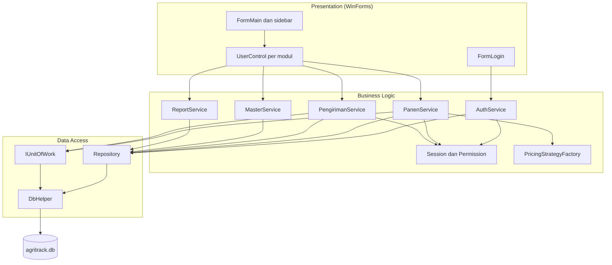
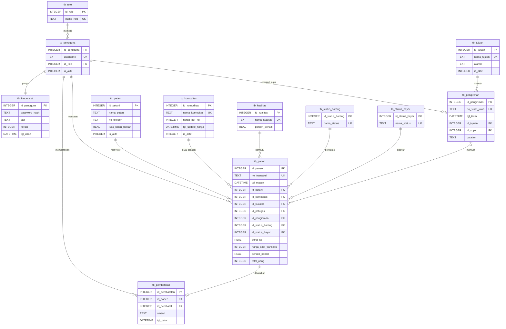

# AgriTrack

Aplikasi desktop offline untuk mengelola operasional pergudangan hasil bumi di Koperasi Unit Desa (KUD) atau pengepul lokal.

> **Status:** tahap perancangan selesai (PRD v1.2, SRS v1.2, dokumentasi desain). Implementasi kode sedang/akan dikerjakan.
> Proyek Akhir Mata Kuliah Pemrograman Lanjut. Penulis: Kelompok 9

## Latar Belakang

KUD dan pengepul umumnya masih mencatat setoran panen di buku besar. Akibatnya:

- catatan rentan rusak atau hilang,
- petugas sering salah menghitung berat timbangan dikali harga komoditas yang berubah tiap hari,
- stok yang masih di gudang tidak jelas dibanding yang sudah dikirim ke pabrik atau distributor,
- kesalahan input tidak bisa dikoreksi secara tertib dan tidak meninggalkan jejak.

AgriTrack menyelesaikannya dengan mengotomatisasi perhitungan, mencatat setiap transaksi beserta koreksinya, dan menampilkan status barang secara real-time.

## Cara Kerja

1. Petani datang membawa hasil bumi.
2. Petugas Gudang memilih petani dan komoditas, lalu memasukkan berat timbangan dan kualitas. Sistem otomatis mengalikan berat dengan harga patokan hari itu.
3. Transaksi tersimpan dengan status **Di Gudang**.
4. Saat truk datang, Supir mencentang barang di aplikasi, memilih tujuan, lalu membuat surat jalan. Status berubah menjadi **Dikirim**.

## Fitur

| Modul | Fungsi | Prioritas |
|---|---|---|
| Login dan hak akses | Login dengan password ter-hash, menu dan operasi dibatasi per role | Wajib |
| Dashboard | Total petani, stok gudang (kg), jumlah transaksi hari ini | Wajib |
| Master Petani | CRUD anggota kelompok tani (nonaktif, bukan hapus) | Wajib |
| Master Komoditas dan Tujuan | Tambah komoditas, perbarui harga harian, kelola tujuan pengiriman | Wajib |
| Setor Panen | Total dihitung otomatis, penalti panen basah, validasi harga harian dan harga basi | Wajib |
| Pembatalan Transaksi | Koreksi oleh Admin dengan alasan, tercatat dan tidak menghapus data | Wajib |
| Manifest dan Surat Jalan | Checklist barang Di Gudang, satu surat jalan per pengiriman | Wajib |
| Laporan Rekapitulasi | Tabel gabungan dengan filter tanggal dan status | Wajib |
| Cetak nota, ekspor CSV, backup database | Fitur pendukung | Seharusnya |
| Status pembayaran | Tandai transaksi Lunas | Opsional |

### Hak Akses

| Permission | Admin | Gudang | Supir |
|---|---|---|---|
| LihatDashboard | Ya | Ya | - |
| KelolaMaster (petani, komoditas, harga, tujuan) | Ya | - | - |
| InputPanen | Ya | Ya | - |
| BatalkanPanen | Ya | - | - |
| BuatSuratJalan | Ya | - | Ya |
| KelolaPembayaran | Ya | - | - |
| LihatLaporan dan ekspor CSV | Ya | - | - |
| BackupDb | Ya | - | - |

Hak akses diperiksa di antarmuka (menu disembunyikan) dan di lapisan service (operasi ditolak).

### Aturan Bisnis Utama

- **Isolasi harga:** harga, penalti, dan total disimpan sebagai snapshot saat Simpan. Perubahan harga master tidak memengaruhi transaksi lama.
- **Panen basah:** penalti dibaca dari tabel kualitas (Basah = 10%) lalu diterapkan pada harga sebelum dikalikan berat.
- **Harga harian:** setor panen diblokir bila harga komoditas belum diperbarui hari ini. Bila harga berubah saat form terbuka, petugas diminta konfirmasi total baru.
- **Pembatalan:** hanya Admin, hanya untuk barang yang masih di gudang, wajib beralasan.
- **Surat jalan atomik:** semua barang terpilih berubah status dalam satu transaksi, atau tidak ada yang berubah.
- **Integritas data:** petani, komoditas, tujuan, dan pengguna yang sudah punya riwayat dinonaktifkan, bukan dihapus.

## Teknologi

- C# (.NET Framework atau .NET Core), Windows Forms
- SQLite lewat `System.Data.SQLite` (NuGet), tanpa server database
- Berjalan sepenuhnya offline, untuk satu instalasi pada satu komputer

## Arsitektur

Tiga lapisan: Presentation (WinForms, satu jendela dengan panel yang berganti), Business Logic (service), dan Data Access (repository). Service bergantung pada antarmuka dengan dependency injection manual di `Program.cs`.



Pola desain yang dipakai:

- **Strategy:** `IPricingStrategy` (Normal, Basah) untuk perhitungan harga.
- **Repository:** `IRepository` per tabel dan `IPanenRepository` untuk query khusus.
- **Unit of Work:** `IUnitOfWork` untuk transaksi atomik (penyimpanan panen, surat jalan, pembatalan).
- **Singleton:** `Session` untuk pengguna aktif, dengan `Authorize(permission)`.

## Skema Database

Dua belas tabel, memenuhi 3NF, dengan seluruh kunci primer dan kunci asing bertipe INTEGER.



Catatan desain:

- Nomor cetak `TRX-YYMMDD-NNN` dan `SJ-YYMMDD-NNN` disimpan di kolom unik `no_transaksi` dan `no_surat_jalan`, bukan sebagai kunci primer.
- Nilai domain (role, kualitas, status, tujuan) dirujuk lewat tabel referensi. Data awalnya diisi otomatis dengan ID yang sama dengan enum C#.
- Kolom snapshot (`harga_saat_transaksi`, `persen_penalti`, `total_uang`) sengaja disimpan agar transaksi lama tidak berubah.
- `PRAGMA foreign_keys = ON` dijalankan di setiap koneksi.
- DDL lengkap, query penting, dan analisis normalisasi ada di dokumentasi desain (`docs/`).

## Struktur Proyek (rencana)

```
AgriTrack/
├── AgriTrack.sln
├── AgriTrack/
│   ├── Models/        Pengguna, Petani, Komoditas, Panen, Pengiriman,
│   │                  Pembatalan, Kredensial, enum Permission, StatusBarang
│   ├── Data/          DbHelper, IRepository, IPanenRepository, PanenRepository,
│   │                  repository master, IUnitOfWork, SqliteUnitOfWork
│   ├── Pricing/       IPricingStrategy, NormalPricing, BasahPricing,
│   │                  PricingStrategyFactory
│   ├── Services/      AuthService, MasterService, PanenService,
│   │                  PengirimanService, ReportService
│   ├── Forms/         FormLogin, FormMain
│   ├── Controls/      UCDashboard, UCPetani, UCKomoditas,
│   │                  UCSetorPanen, UCManifest, UCLaporan
│   ├── Helpers/       Session, PasswordHasher, NotaPrinter,
│   │                  CsvExporter, BackupHelper
│   └── Program.cs
├── docs/              PRD, SRS, dokumentasi desain
└── README.md
```

## Menjalankan Proyek

Prasyarat: Windows, Visual Studio dengan workload ".NET desktop development".

1. Clone repo:
   ```bash
   git clone <url-repo>
   cd AgriTrack
   ```
2. Buka `AgriTrack.sln` di Visual Studio.
3. Restore paket NuGet (otomatis saat build). Paket utama: `System.Data.SQLite`.
4. Jalankan (F5).

Saat pertama dijalankan, aplikasi membuat berkas `agritrack.db`, mengisi tabel referensi, dan membuat akun Admin awal secara otomatis. Segera ganti password akun awal setelah login pertama.

> Berkas database dibuat otomatis, jadi tidak perlu di-commit. Tambahkan `*.db`, `bin/`, `obj/`, dan `.vs/` ke `.gitignore`.

## Dokumentasi

- PRD (Product Requirements Document) v1.2
- SRS (Software Requirements Specification) v1.2
- Dokumentasi desain sistem: arsitektur, ERD, normalisasi, DDL, use case, activity, sequence, state, dan class diagram

Simpan salinannya di folder `docs/`.

## Checklist Pengerjaan

**Wajib**

- [ ] Database, `DbHelper`, dan data awal tabel referensi
- [ ] Login, hash password, `Session`, dan permission
- [ ] Master Petani
- [ ] Master Komoditas dan Tujuan
- [ ] Setor Panen (strategi harga, validasi harga harian dan harga basi, snapshot)
- [ ] Pembatalan transaksi
- [ ] Manifest dan surat jalan
- [ ] Dashboard
- [ ] Laporan dengan filter

**Seharusnya**

- [ ] Cetak nota petani
- [ ] Ekspor laporan CSV
- [ ] Backup database

**Opsional**

- [ ] Status pembayaran

**Penutup**

- [ ] Pengujian dan finalisasi dokumen

