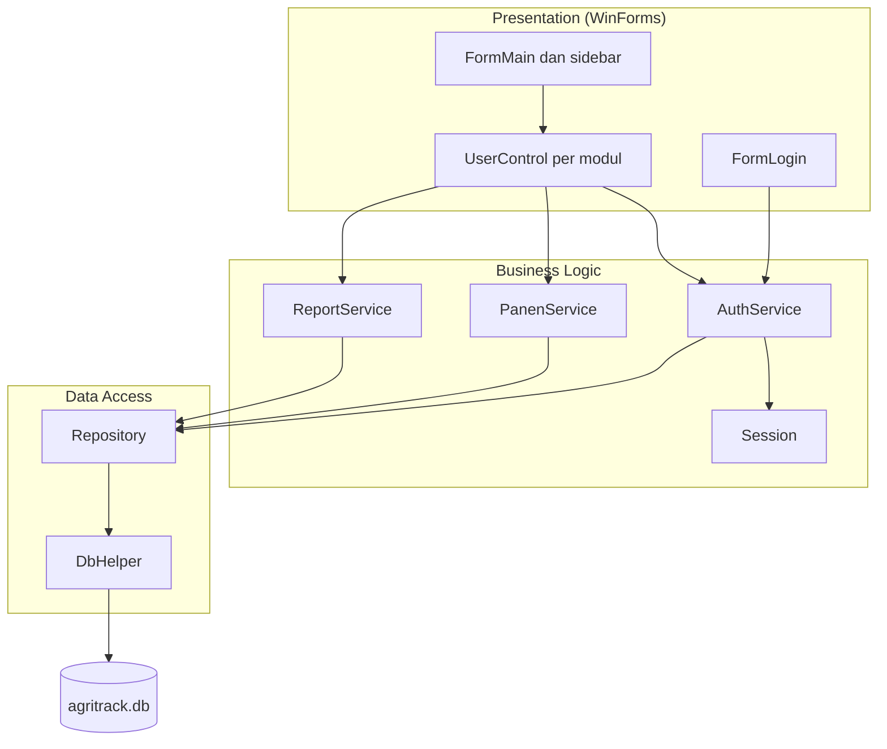
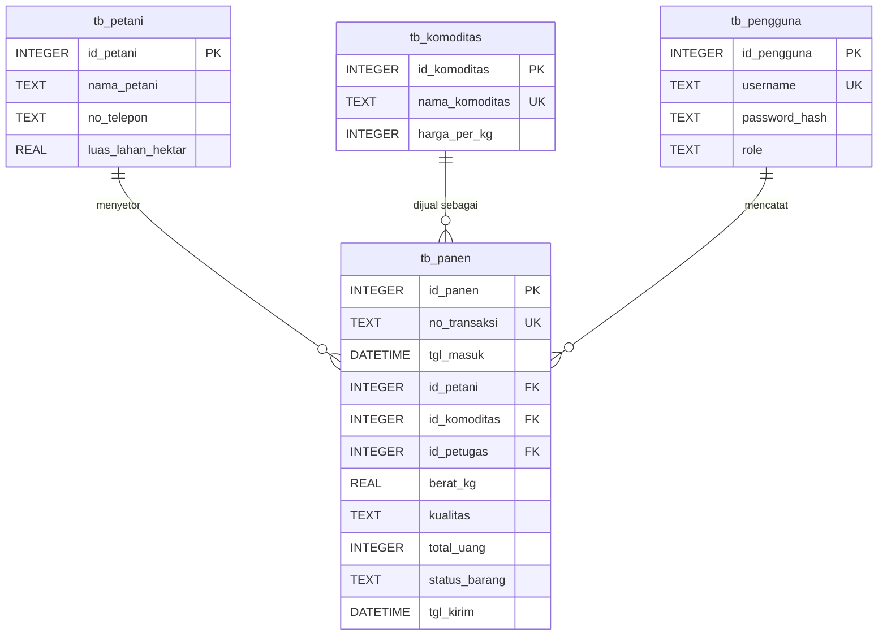

# AgriTrack

Aplikasi desktop offline untuk mengelola operasional pergudangan hasil bumi di Koperasi Unit Desa (KUD) atau pengepul lokal.

> **Status:** tahap perancangan selesai (PRD v1.1, SRS v1.1, dokumentasi desain). Implementasi kode sedang/akan dikerjakan.
> Proyek Akhir Mata Kuliah Pemrograman Lanjut. Penulis: [Nama Mahasiswa]

## Latar Belakang

KUD dan pengepul umumnya masih mencatat setoran panen di buku besar. Akibatnya:

- catatan rentan rusak atau hilang,
- petugas sering salah menghitung berat timbangan dikali harga komoditas yang berubah tiap hari,
- stok yang masih di gudang tidak jelas dibanding yang sudah dikirim ke pabrik atau distributor.

AgriTrack menyelesaikannya dengan mengotomatisasi perhitungan, mencatat setiap transaksi, dan menampilkan status barang secara real-time.

## Cara Kerja

1. Petani datang membawa hasil bumi.
2. Petugas Gudang memilih petani dan komoditas, lalu memasukkan berat timbangan dan kualitas. Sistem otomatis mengalikan berat dengan harga patokan hari itu.
3. Transaksi tersimpan dengan status **Di Gudang**.
4. Saat truk datang, Supir mencentang barang di aplikasi. Status berubah menjadi **Dikirim**.

## Fitur

| Modul | Fungsi |
|---|---|
| Dashboard | Total petani, stok gudang (kg), jumlah transaksi hari ini |
| Master Petani | CRUD data anggota kelompok tani |
| Master Komoditas | Tambah komoditas dan perbarui harga patokan harian (Admin) |
| Setor Panen | Input berat dan kualitas, total dihitung otomatis secara real-time |
| Manifest Pengiriman | Checklist barang berstatus Di Gudang untuk diubah menjadi Dikirim secara massal |
| Laporan Rekapitulasi | Tabel gabungan dengan filter rentang tanggal dan status |

### Hak Akses

| Menu | Admin | Gudang | Supir |
|---|---|---|---|
| Dashboard | Ya | Ya | - |
| Master Petani | Ya | - | - |
| Master Komoditas | Ya | - | - |
| Setor Panen | Ya | Ya | - |
| Manifest Pengiriman | Ya | - | Ya |
| Laporan Rekapitulasi | Ya | - | - |

### Aturan Bisnis Utama

- **Isolasi harga:** `total_uang` dihitung dan disimpan permanen saat tombol Simpan ditekan. Perubahan harga master tidak memengaruhi transaksi lama.
- **Panen basah:** kualitas "Basah" dikenai potongan harga 10% sebelum dikalikan berat.
- **Integritas data:** petani dan komoditas yang sudah punya riwayat panen tidak boleh dihapus.

## Teknologi

- C# (.NET Framework atau .NET Core), Windows Forms
- SQLite lewat `System.Data.SQLite` (NuGet), tanpa server database
- Berjalan sepenuhnya offline

## Arsitektur

Tiga lapisan: Presentation (WinForms, satu jendela dengan panel yang berganti), Business Logic (service), dan Data Access (repository).



## Skema Database

Empat tabel, memenuhi 3NF.



Catatan desain:

- Semua kunci primer dan kunci asing bertipe INTEGER. Nomor transaksi `TRX-YYMMDD-001` disimpan di kolom unik `no_transaksi`.
- `password_hash` berisi satu string hasil hashing yang sudah memuat salt.
- `PRAGMA foreign_keys = ON` dijalankan di setiap koneksi.
- Waktu disimpan dalam waktu lokal agar "Transaksi Hari Ini" dan nomor TRX sesuai tanggal setempat.
- DDL lengkap ada di dokumentasi desain (`docs/`).

## Struktur Proyek (rencana)

```
AgriTrack/
├── AgriTrack.sln
├── AgriTrack/
│   ├── Models/        Pengguna, Petani, Komoditas, Panen
│   ├── Data/          DbHelper, PenggunaRepository, PetaniRepository,
│   │                  KomoditasRepository, PanenRepository
│   ├── Services/      AuthService, PanenService, ReportService
│   ├── Forms/         FormLogin, FormMain
│   ├── Controls/      UCDashboard, UCPetani, UCKomoditas,
│   │                  UCSetorPanen, UCManifest, UCLaporan
│   ├── Helpers/       Session, PasswordHasher
│   └── Program.cs
├── docs/              PRD, SRS, dokumentasi desain
└── README.md
```

## Menjalankan Proyek

Prasyarat: Windows, Visual Studio dengan workload ".NET desktop development".

1. Clone repo:
   ```bash
   git clone <url-repo>
   cd AgriTrack
   ```
2. Buka `AgriTrack.sln` di Visual Studio.
3. Restore paket NuGet (otomatis saat build). Paket utama: `System.Data.SQLite`.
4. Jalankan (F5).

Saat pertama dijalankan, aplikasi membuat berkas `agritrack.db` dan akun Admin awal secara otomatis. Segera ganti password akun awal setelah login pertama.

> Berkas database dibuat otomatis, jadi tidak perlu di-commit. Tambahkan `*.db`, `bin/`, `obj/`, dan `.vs/` ke `.gitignore`.

## Dokumentasi

- PRD (Product Requirements Document) v1.1
- SRS (Software Requirements Specification) v1.1
- Dokumentasi desain sistem: arsitektur, ERD, use case, activity, sequence, state, dan class diagram

Simpan salinannya di folder `docs/`.

## Checklist Pengerjaan

- [ ] Database dan `DbHelper` (inisialisasi tabel, akun Admin awal)
- [ ] Login, `Session`, dan menu berbasis role
- [ ] Master Petani
- [ ] Master Komoditas
- [ ] Setor Panen (hitung otomatis, penalti Basah, nomor transaksi)
- [ ] Manifest Pengiriman (checklist dan kirim massal)
- [ ] Dashboard
- [ ] Laporan dengan filter
- [ ] Pengujian dan finalisasi dokumen

## Lisensi

[Tentukan lisensi, misalnya MIT, atau hapus bagian ini]